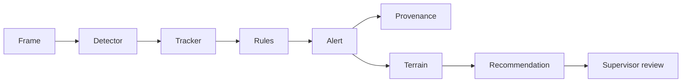

# AI and Decision Components

IBVAP does not currently contain an LLM agent or MCP agent. It contains deterministic computer-vision and decision-support services.

| Component | Role | Inputs | Outputs | Guardrails |
|---|---|---|---|---|
| `YOLODetector` | Detect objects in frames | BGR image, ONNX weights | Classes, confidence, boxes, posture/animal metadata | Thresholds, NMS, target-class allowlist |
| `ObjectTracker` | Maintain identities across frames | Detections and history | Track IDs, centroids, dwell time | Bounded worker flow and missed-frame policy |
| Rule engine | Convert tracked behavior into events | Tracks, persisted rules | Alerts, evidence, ledger, C2 event | Cooldowns, friendly/animal suppression, provenance |
| Model registry | Manage model versions | Deployment metadata | Active/staged/rollback state | Promotion and rollback audit |
| Recommendation service | Produce tactical decision support | Alert and terrain data | Actions, factors, citations, uncertainty | Supervisor review required |
| Provenance service | Bind model/rule metadata to alerts | Alert and model metadata | Hashes and verification result | Detector vs simulation distinction |

## Orchestration

## Failure handling

Detector failure must not be represented as a successful detection. The worker records errors and continues with isolation. Simulation events must be labelled `simulation`. Recommendations are advisory and require human review before operational use.
