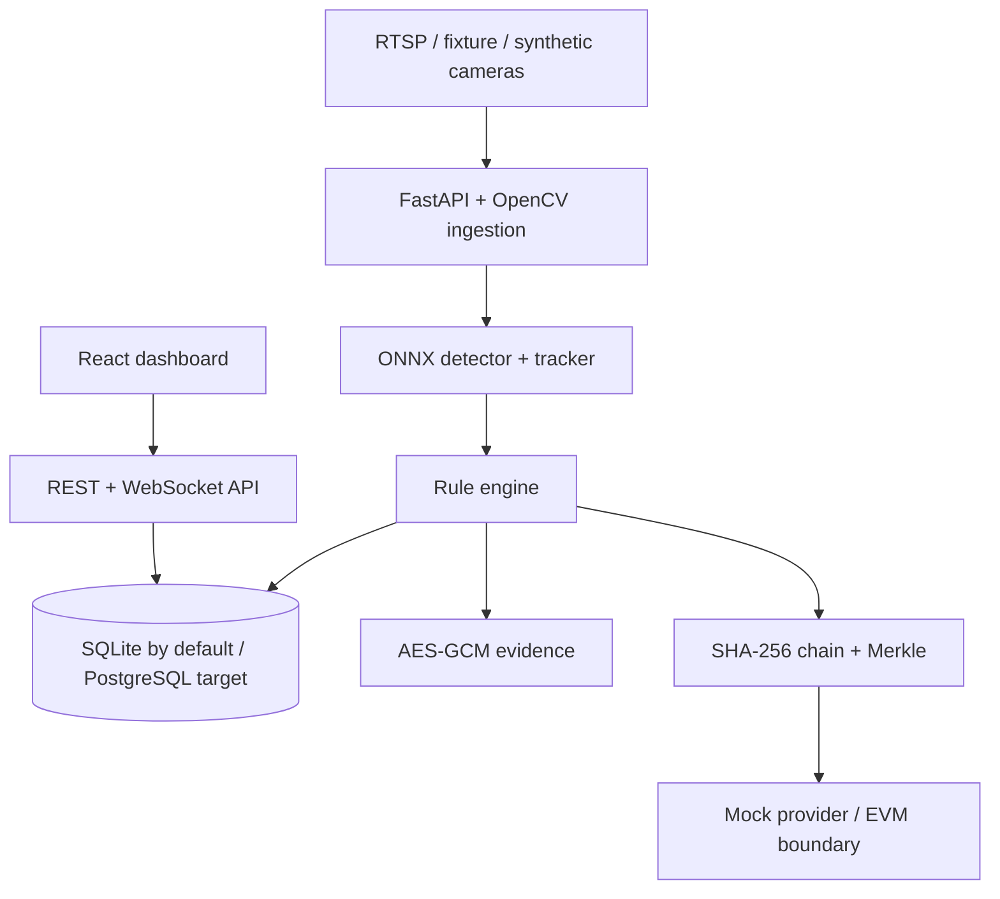

# IBVAP Architecture

## Overview

IBVAP currently consists of a React/Vite command center, a FastAPI service, SQLAlchemy persistence, OpenCV/ONNX processing, WebSockets, and Solidity reference contracts.

## Data flow

Frames enter a bounded queue, are analysed, tracked, evaluated against persisted rules, and may create an encrypted evidence asset, alert, ledger record, C2 delivery, and WebSocket event. The UI reads authoritative camera/alert data and clearly labels local simulation.

## Technology decisions

FastAPI and React are retained because they are already implemented and support the required browser/API workflows. SQLAlchemy preserves a path from SQLite pilot deployment to PostgreSQL. The mock blockchain provider keeps tests offline; live EVM submission remains a separate implementation boundary.

## Scalability target

The current process-local worker, cooldown, retry, and WebSocket state supports a single hub. Production scale requires PostgreSQL, object storage, a durable queue, shared event transport, worker orchestration, and multiple API replicas. These are architectural follow-up items, not claims about the current implementation.

## Deployment topology

For the current pilot, run the FastAPI container behind a TLS reverse proxy and serve the built frontend from the same deployment or a static host. Keep the database and encryption keys on protected volumes. Production should separate API, worker, database, object storage, and event transport.
