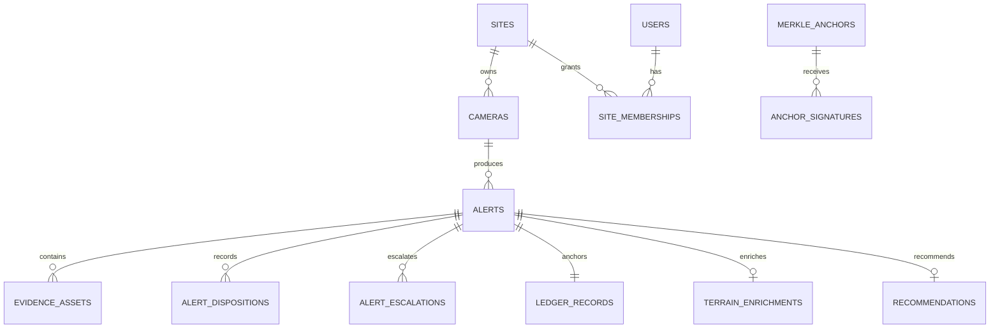

# IBVAP Database

## Current storage

SQLAlchemy models are defined in `ibvap-backend/app/models.py`. The default database is SQLite at `ibvap.db`; PostgreSQL can be supplied through `DATABASE_URL`. The application currently calls `Base.metadata.create_all()` and does not yet have Alembic migrations.

## ER diagram

## Important entities

| Entity | Key fields | Purpose |
|---|---|---|
| `sites` | id, region, timezone, retention_days | Tenancy and policy scope |
| `users` | username, hashed_password, role, lockout fields | Authentication |
| `site_memberships` | user_id, site_id, role, status | Site-scoped authorization |
| `cameras` | site_id, source, online, night, model/rule versions | Sensor inventory |
| `alerts` | type, severity, state, provenance, hashes, encrypted fields | Operational events |
| `evidence_assets` | content_hash, encrypted_data, retention | Protected evidence |
| `ledger_records` | seq, prev_hash, record_hash | Tamper-evident chain |
| `ledger_anchors` | root, sequence range, transaction metadata | External commitment |
| `audit_log` | username, action, site_id, timestamp | Human action audit |

## Indexes and relations

The models define indexes for provenance, transaction hash, anchor status/time, and anchor sequence ranges. Foreign keys tie site and alert records together. A production migration must add any missing composite indexes for alert search and retention cleanup.

## Migration and backup policy

Before production launch, add Alembic migrations and require an explicit migration step. Backups must be encrypted, checksummed, signed, tested by restore, and protected by legal holds. The existing backup service provides application-level backup/validation behavior but does not replace infrastructure backups.
