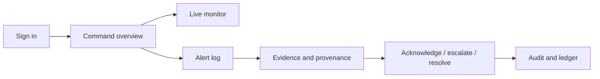

# IBVAP UI/UX Design

## Principles

Clarity over decoration, high-contrast operational states, explicit provenance, keyboard accessibility, resilient degraded states, and no silent fallback from authenticated production behavior to synthetic data.

## Core flow

## Screens

| Screen | Purpose | Required states |
|---|---|---|
| Sign-in | Establish authenticated session | Invalid credentials, locked account, unavailable API |
| Command overview | Site-level operational summary | Loading, empty site, degraded readiness |
| Live monitor | Inspect camera feeds and detections | Offline camera, stream error, permission error |
| Camera matrix | Compare multiple cameras | Missing frame, stale telemetry |
| Alert log | Filter and triage events | Empty, loading, permission denied |
| Evidence | Review protected evidence | Missing evidence, legal hold, integrity failure |
| AI pipeline | Inspect model status and provenance | Model unavailable, staged, active, rollback |

## Components and design system

The current frontend uses React components, Tailwind CSS, DaisyUI, Lucide/Tabler icons, and a light/dark theme. Severity colors must not be the only signal: pair color with text, icon, and accessible labels. Destructive operations require confirmation and an audit reason.

## Accessibility

Use semantic buttons and headings, visible focus states, keyboard-operable modals, `aria-live` for new alerts, captions/alt text for evidence, reduced-motion support, and WCAG AA contrast. Camera permission failures must be actionable and must not expose credentials.

## Error and empty states

Every data surface must distinguish loading, empty, stale, unauthorized, unavailable, and server-error states. A local simulation must be labelled `simulation` and never masquerade as detector output.
